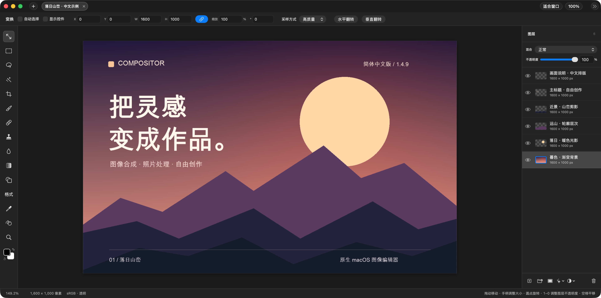

# Compositor 简体中文版

[English](README.md) | [简体中文](README.zh-CN.md)

这是 [Robbie Tilton 的 Compositor](https://github.com/robbietilton/Compositor) 的**简体中文汉化版本**，由本仓库独立维护，并非原作者发布的官方中文版。Compositor 是一款免费、开源的原生 macOS 图像编辑器，面向图像合成、照片处理和精细修图工作流。

本项目的原则是：**功能与上游对应版本保持一致，只做语言汉化**。不另行增加或修改图像编辑功能；除本地化所需的适配外，仅调整中文版的文档、签名、打包和更新渠道。



## 与原项目的关系

- 原始项目：[robbietilton/Compositor](https://github.com/robbietilton/Compositor)。应用的设计与核心功能归功于原作者及上游贡献者。
- 中文项目：[emptykid/Compositor](https://github.com/emptykid/Compositor)。维护简体中文翻译及中文版发行包。
- 当前版本：**1.4.9，构建号 44**，对应上游 [v1.4.9](https://github.com/robbietilton/Compositor/releases/tag/v1.4.9)，基于提交 `0ab3ff5`。
- 版本策略：应用版本号与所同步的上游正式版一致；上游发布后，人工合并、更新翻译并完成验证，再发布对应中文版，不承诺实时同步。
- 兼容性：保留原有 `.comp` 项目格式、混合模式等存储值及快捷键标识。已有图层名称、文件名和用户输入的文字不会因切换语言而被翻译。

## 下载与安装

从[本仓库的 Releases](https://github.com/emptykid/Compositor/releases/latest) 下载 `Compositor.dmg`，打开后将 `Compositor.app` 拖入“应用程序”文件夹。

需要 **Apple 芯片 Mac、macOS 26.0 或更高版本**。安装包的签名和 Apple 公证状态以对应 Release 的说明为准。

当前 1.4.9 中文应用与 DMG 均已完成 **Developer ID 签名和 Apple 公证**，并已附加公证票据。安装包在首次发布后补充了公证，应用版本仍为 **1.4.9（构建号 44）**；此前已下载未公证安装包的用户可重新下载。

原项目官网、原项目 Releases 和 `brew install --cask robbietilton-compositor` 提供的是上游版本，并非本仓库维护的中文版。

## 中文与英文切换

应用内置英语和简体中文，默认跟随 macOS 的语言偏好，没有单独的应用内语言开关。

如需仅为 Compositor 指定中文：

1. 打开“系统设置 → 通用 → 语言与地区”。
2. 在“应用程序”中添加 Compositor，并选择“简体中文”。
3. 退出并重新打开 Compositor。

改回英语时，在同一位置选择英语并重启应用即可。新建图层、文件夹等默认名称在创建时使用当前语言，已有项目中的名称保持原样。

## 汉化范围

当前版本包含 **1223 条中英文词条**，覆盖主菜单、工具名称与提示、图层与混合模式、调整与滤镜面板、Camera Raw、新建画布、导入导出、快捷键设置、命令搜索及主要弹窗。

中文命令搜索可用 `⌘F` 打开。翻译仅作用于界面显示；菜单操作、项目存储值和已保存的快捷键设置使用原有稳定标识。

中文版使用本仓库独立的更新源和更新签名密钥，避免被原项目的英文发行包覆盖。未来的更新也只从本仓库获取。

## 功能

功能沿用上游对应版本，完整介绍见[英文 README](README.md#features)。主要包括：

- 图层、文件夹、混合模式、图层蒙版、剪贴蒙版、调整图层和可编辑图层效果。
- 非破坏性的移动、缩放、旋转、翻转与自由变形，支持参考线和吸附。
- 选框、套索、魔棒、对象选择、主体选择及内容识别填充。
- 画笔、橡皮擦、修复画笔、仿制图章、模糊、渐变、形状与可编辑文字。
- Camera Raw、色阶、曲线、色相／饱和度、曝光、色彩平衡及多种滤镜。
- 多项目标签页、命令搜索、标尺、网格、画布尺寸、图像尺寸与裁剪。
- 导入 JPEG、PNG、HEIC、TIFF、WebP、SVG、相机 RAW、Photoshop PSD／PSB；导出 PNG、JPEG 和单页 PDF。
- Photoshop 风格的可自定义快捷键，以及可供脚本和 AI 代理直接编辑的 `.comp` 项目格式。

## 从源码运行

需要 **Xcode 26 或更高版本**。打开 `Compositor.xcodeproj`，选择 **Compositor** scheme 并运行，或执行：

```sh
xcodebuild -project Compositor.xcodeproj -scheme Compositor -destination 'platform=macOS' build
```

本地构建的开发版会跟随 macOS 的应用语言偏好。翻译结构、词条校验和中英文测试方法见[本地化维护文档](docs/localization.md)。

## 反馈与维护

欢迎通过本仓库的 Pull Request 修正翻译、术语和中文显示问题。功能需求与通用图像编辑问题优先反馈至[原始项目](https://github.com/robbietilton/Compositor)。

本项目不维护独立的功能分支。同步上游时保持核心行为一致，并验证中文显示、命令搜索、混合模式选择、撤销及项目兼容性。

## 许可证与致谢

采用 [MIT 许可证](LICENSE)，保留原项目的版权声明。感谢 Robbie Tilton 及所有上游贡献者；本仓库负责简体中文本地化维护。
